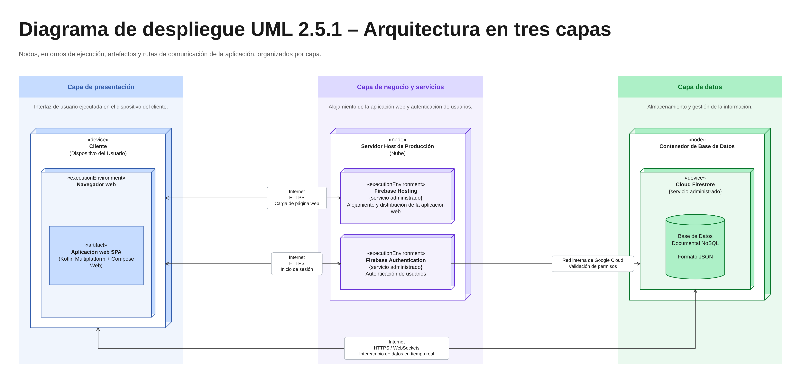

## 1. Diagrama de componentes

### 1.1 Diagrama

**Link:** <https://miro.com/app/board/uXjVEOgSu50=/?share_link_id=225720993955>

### 1.2 Dependencias y mecanismos de comunicación

- **Conectores de ensamblaje:** unen la interfaz requerida de un componente con la proporcionada por otro dentro de la API (por ejemplo, Turnos y programación → Validación de conflictos → Motor de validación de conflictos).
- **Conectores de delegación «delegate»:** conectan los puertos del borde de la API con las partes internas que realizan el trabajo: las solicitudes de la aplicación web se delegan en Seguridad y permisos; la verificación de identidad sale desde el Módulo Autenticación; los envíos externos salen desde Notificaciones, y la persistencia sale desde Acceso a datos.
- **Dependencia «permite solo lo autorizado»:** la lógica de negocio solo recibe solicitudes que Seguridad y permisos ya validó, de modo que ningún módulo queda expuesto directamente.
- **Comunicación externa:** JSON sobre HTTPS con token JWT entre la aplicación web y la API; OpenID Connect sobre HTTPS con Google; Firebase Admin SDK (gRPC sobre HTTPS) con Cloud Firestore; HTTPS con la API del proveedor de notificaciones; el protocolo con Gmail está pendiente de confirmación.

### 1.3 Relación entre los componentes y las funcionalidades del MVP

La tabla relaciona cada módulo con las historias de usuario del User Story Mapping y el MVP en el que se ubican.

| Componente | Historias de usuario | MVP |
|---|---|---|
| Módulo Autenticación; Seguridad y permisos | HU-01 Login; HU-02 Recuperación de clave | MVP 1 |
| Módulo Empleados | HU-03 Creación de empleados; HU-04 Actualización de empleados | MVP 1 |
| Módulo Turnos y programación; Motor de validación de conflictos; Disponibilidad | HU-05 Creación de turnos; HU-06 Asignación de turnos; HU-08 Ver horario asignado; HU-07 Visualización de horarios por sucursal | MVP 1 (HU-07 en MVP 2) |
| Módulo Cambios de turno; Motor de validación de conflictos; Planificador de tareas | HU-09 Solicitar cambio de turno; HU-12 Aprobar cambios de turno | MVP 2 |
| Módulo Novedades | HU-10 Reportar novedades; HU-11 Ver novedades; HU-13 Reportar novedades de empleado | MVP 2 |
| Módulo Asistencia e incumplimientos; Planificador de tareas; Notificaciones | HU-14 Marcar asistencia; HU-15 Registro por el supervisor; HU-16 Notificaciones de incumplimientos | MVP 2 (HU-15 y HU-16 en MVP 3) |
| Notificaciones; Auditoría; Acceso a datos | Servicios de soporte para todas las historias: avisos, trazabilidad y persistencia | Transversal |
## 2. Diagrama de despliegue

### 2.1 Diagrama

**Link:** <https://miro.com/app/board/uXjVENWWheE=/?share_link_id=914651473422>

### 2.2 Nodos, entornos de ejecución y artefactos

| Capa | Nodo / entorno | Tipo | Artefactos y función |
|---|---|---|---|
| Presentación | «device» Cliente (dispositivo del usuario) | Dispositivo | Contiene el entorno de ejecución Navegador web. |
| | «executionEnvironment» Navegador web | Entorno de ejecución | Ejecuta el «artifact» Aplicación web SPA (Kotlin Multiplatform + Compose Web). |
| Negocio y servicios | «node» Servidor Host de Producción (nube) | Nodo en la nube | Agrupa los servicios administrados de Firebase. |
| | «executionEnvironment» Firebase Hosting {servicio administrado} | Servicio en la nube | Aloja y distribuye la aplicación web. |
| | «executionEnvironment» Firebase Authentication {servicio administrado} | Servicio en la nube | Autentica a los usuarios. |
| Datos | «node» Contenedor de Base de Datos | Nodo en la nube | Contiene el servicio de base de datos. |
| | «device» Cloud Firestore {servicio administrado} | Servicio en la nube | Base de datos documental NoSQL. |

## 3. Decisiones arquitectónicas

- **Arquitectura en tres capas.** Separa presentación, negocio y servicios, y datos, de modo que cada capa pueda evolucionar o reemplazarse sin afectar a las demás.
- **Servicios administrados de Firebase para el MVP.** Hosting, Authentication y Cloud Firestore eliminan la necesidad de operar servidores propios, ofrecen HTTPS por defecto y escalan automáticamente, lo que se ajusta al tamaño de la operación (tres sucursales) y al alcance del MVP.
- **Aplicación web en Kotlin Multiplatform y Compose.** Una sola tecnología (Kotlin) para la interfaz y para el backend proyectado (Kotlin + Ktor), lo que facilita compartir modelos y reglas entre capas.
- **Base de datos documental con sincronización en tiempo real.** La conexión HTTPS / WebSockets con Cloud Firestore permite que horarios, solicitudes y novedades se actualicen en la pantalla sin recargar la página.
- **Autenticación delegada.** La identidad se verifica con un proveedor externo (OpenID Connect / Firebase Authentication) y el acceso se controla con token; el sistema no almacena contraseñas propias y la recuperación de clave se resuelve con el proveedor.
- **API modular organizada por responsabilidad.** Los paquetes Seguridad, Lógica de negocio y Servicios transversales, con un módulo por grupo de historias, reducen el acoplamiento: cada módulo depende de interfaces (contratos lógicos) y no de implementaciones concretas.
- **Seguridad como punto único de entrada.** Toda solicitud externa se delega en Seguridad y permisos antes de llegar a la lógica de negocio.
- **Servicios transversales centralizados.** Notificaciones, Auditoría y Acceso a datos evitan duplicar código en los módulos; Acceso a datos aísla la tecnología de persistencia.
- **Componentes de validación y planificación independientes.** El Motor de validación de conflictos y Disponibilidad se reutilizan en la asignación y en el intercambio de turnos; el Planificador de tareas concentra los eventos de tiempo (vencimiento de solicitudes y evaluación de los turnos del día).
- **Proveedores externos intercambiables.** Los envíos de correo y avisos salen por puertos de delegación de Notificaciones, por lo que el proveedor puede cambiarse o definirse más adelante sin afectar a los módulos.

## 4. Correspondencia entre los componentes y su despliegue

Ambos diagramas son vistas complementarias de la misma arquitectura. La tabla indica en qué nodo o artefacto se materializa cada componente y si está desplegado en el MVP o es un elemento proyectado.

| Componente | Elemento de despliegue | Estado |
|---|---|---|
| Aplicación web (Kotlin/Wasm + Compose Multiplatform) | «artifact» Aplicación web SPA, ejecutada en el Navegador web del «device» Cliente y distribuida por Firebase Hosting | Desplegado |
| Google · OpenID Connect (verificación de identidad) | «executionEnvironment» Firebase Authentication | Desplegado |
| Firebase Cloud Firestore | «device» Cloud Firestore dentro del Contenedor de Base de Datos (base de datos documental NoSQL) | Base de datos desplegada; acceso desde la API proyectado |
| API REST de turnos: Seguridad y permisos, seis módulos de negocio, Motor de validación de conflictos, Planificador de tareas, Disponibilidad, Notificaciones, Auditoría y Acceso a datos | Sin nodo en el despliegue actual. Se desplegará como artefacto JVM (Kotlin + Ktor) en la capa de negocio y servicios | Proyectado {planeado} |
| Gmail; Servicio externo de notificaciones | Sin representación en el despliegue actual | Proyectado |
