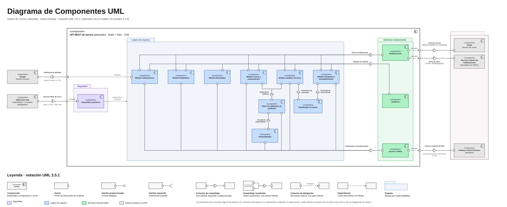

## 1. Diagrama de componentes

### 1.1 Diagrama

**Link:** <https://miro.com/app/board/uXjVEOgSu50=/?share_link_id=225720993955>

### 1.2 Dependencias y mecanismos de comunicación

- **Conectores de ensamblaje:** unen la interfaz requerida de un componente con la proporcionada por otro dentro de la API (por ejemplo, Turnos y programación → Validación de conflictos → Motor de validación de conflictos).
- **Conectores de delegación «delegate»:** conectan los puertos del borde de la API con las partes internas que realizan el trabajo: las solicitudes de la aplicación web se delegan en Seguridad y permisos; la verificación de identidad sale desde el Módulo Autenticación; los envíos externos salen desde Notificaciones, y la persistencia sale desde Acceso a datos.
- **Dependencia «permite solo lo autorizado»:** la lógica de negocio solo recibe solicitudes que Seguridad y permisos ya validó, de modo que ningún módulo queda expuesto directamente.
- **Comunicación externa:** JSON sobre HTTPS con token JWT entre la aplicación web y la API; OpenID Connect sobre HTTPS con Google; Firebase Admin SDK (gRPC sobre HTTPS) con Cloud Firestore; HTTPS con la API del proveedor de notificaciones; el protocolo con Gmail está pendiente de confirmación.

### 1.3 Relación entre los componentes y las funcionalidades del MVP

La tabla relaciona cada módulo con las historias de usuario del User Story Mapping y el MVP en el que se ubican.

| Componente | Historias de usuario | MVP |
|---|---|---|
| Módulo Autenticación; Seguridad y permisos | HU-01 Login; HU-02 Recuperación de clave | MVP 1 |
| Módulo Empleados | HU-03 Creación de empleados; HU-04 Actualización de empleados | MVP 1 |
| Módulo Turnos y programación; Motor de validación de conflictos; Disponibilidad | HU-05 Creación de turnos; HU-06 Asignación de turnos; HU-08 Ver horario asignado; HU-07 Visualización de horarios por sucursal | MVP 1 (HU-07 en MVP 2) |
| Módulo Cambios de turno; Motor de validación de conflictos; Planificador de tareas | HU-09 Solicitar cambio de turno; HU-12 Aprobar cambios de turno | MVP 2 |
| Módulo Novedades | HU-10 Reportar novedades; HU-11 Ver novedades; HU-13 Reportar novedades de empleado | MVP 2 |
| Módulo Asistencia e incumplimientos; Planificador de tareas; Notificaciones | HU-14 Marcar asistencia; HU-15 Registro por el supervisor; HU-16 Notificaciones de incumplimientos | MVP 2 (HU-15 y HU-16 en MVP 3) |
| Notificaciones; Auditoría; Acceso a datos | Servicios de soporte para todas las historias: avisos, trazabilidad y persistencia | Transversal |
